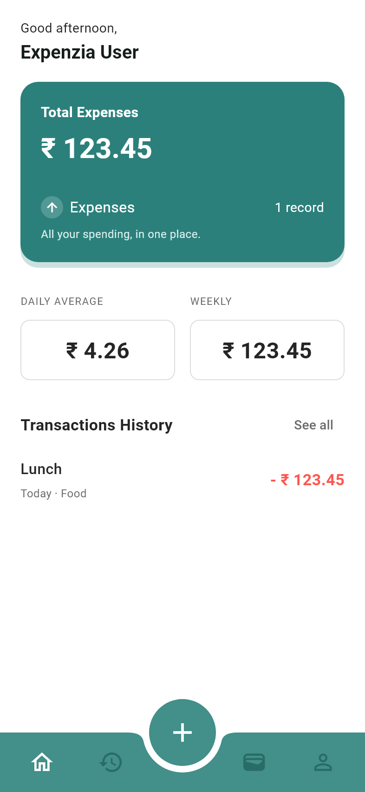
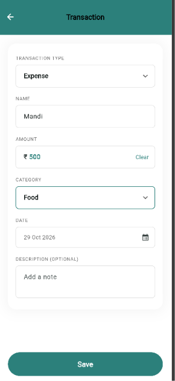
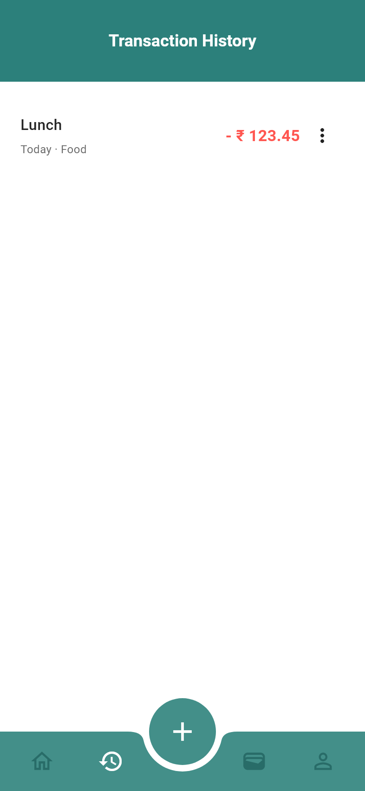
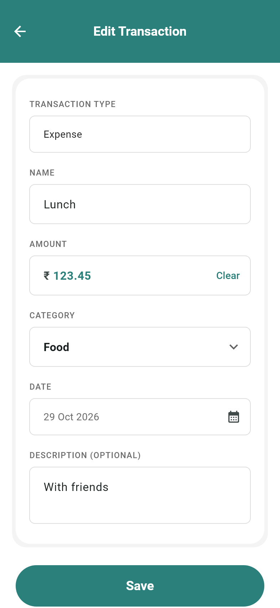
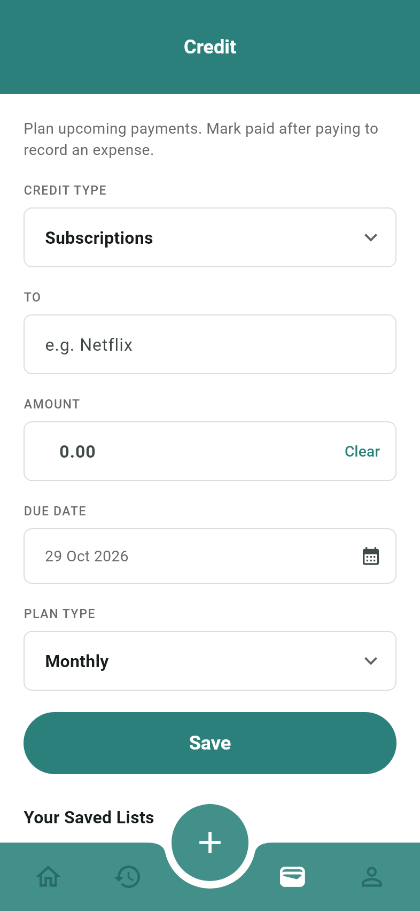
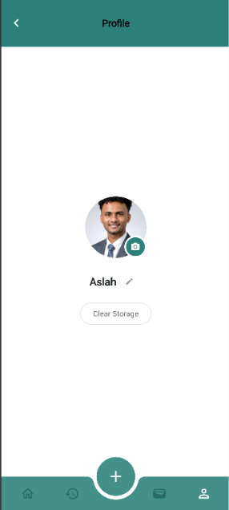

# Expenzia

A Flutter expense manager based on the supplied Lilac Infotech assignment and
screen references. Expenses and the profile name are persisted locally in SQLite.
The application starts with an empty database; it does not seed fictional records.

## Run

Requirements: Flutter 3.44 or newer with Dart 3.12 or newer, and an Android
SDK/device or emulator. Development verification used Flutter 3.47.2 / Dart 3.13.2.
The iOS wrapper is included; building iOS requires macOS and Xcode.

```sh
flutter pub get
flutter devices
flutter run -d <android-device-id>
```

On macOS, select an iOS simulator/device ID instead.

For Chrome, use the browser SQLite adapter and the included worker/WASM files:

```sh
flutter run -d chrome --web-port 8090
```

Browser records are stored locally through SQLite WebAssembly and IndexedDB.
Keep the same hostname and port when restarting to reuse the same browser data.
Clearing browser site data removes those records. Browser and mobile databases
are separate. If upgrading the browser SQLite dependency, regenerate its files:

```sh
dart run sqflite_common_ffi_web:setup --force
```

## Features

- Splash, onboarding, dashboard, transaction history, shared add/edit form,
  functional Credit payment plans, and Profile screens.
- Save, edit, and delete upcoming payments with amounts, due dates, and
  one-time/monthly/yearly schedules. Saving a plan does not add an expense.
- Mark paid adds one expense with today's payment date. One-time plans become
  Paid; recurring plans advance one scheduled cycle while retaining the amount.
- SQLite expense CRUD, confirmation before deletion, and persistent profile names.
- Required title, category, amount, and date; optional description.
- Integer paise throughout storage and calculations, displayed as Indian rupees.
- Positive-amount validation, at most two decimal places, and duplicate-save guards.
- Totals and history refresh through ChangeNotifier after successful writes.
- Loading, empty, retry, and database-error states.
- Scrollable forms, keyboard handling, safe areas, and responsive mobile layouts.
- Clear Storage deletes all expense records after confirmation, retaining the
  profile and payment plans. Deleting a plan retains previously recorded expenses.
- Every application and test Dart file is at most 100 lines after Dart formatting.

## Dependencies

- `sqflite`: Android/iOS SQLite integration.
- `path`: portable database paths.
- `sqflite_common_ffi_web`: browser SQLite backed by IndexedDB.
- Flutter's `ChangeNotifier` and `ListenableBuilder`: state and UI updates.
- Development only: `flutter_test` and `sqflite_common_ffi` for real SQLite tests
  on the development computer. FFI is not used by the production mobile app.

## Structure

```text
lib/
  main.dart, app.dart       Application startup and resource ownership
  models/                  Immutable expense records and dashboard summaries
  data/                    Versioned SQLite CRUD, payment transactions, profiles
  controllers/             Expense state, form state, profile state
  screens/                 Intro flow, navigation shell, and application screens
  theme/                   Shared colours, spacing, typography, and input styling
  widgets/                 Reusable fields, cards, navigation, and state widgets
  utils/                   Integer amount parsing, formatting, validation
test/                      Persistence, state, validation, and widget tests
docs/screenshots/           Rendered previews from actual Flutter widgets
```

Screens call the controller. The controller writes through the database and
publishes the refreshed records. Widgets rebuild when the controller notifies.
Writes and their following read use one SQLite transaction: a failed read rolls
back the mutation. User-provided query values use bound parameters.

## Design decisions and incomplete features

- The PDF requires category and description, so those fields extend the pictured form.
- Screenshot currencies and sample totals conflict. The app uses rupees consistently
  and shows Total Expenses calculated from records. Income and account balances are
  not implemented, and no income values are invented.
- Daily Average is current-month spending through today divided by elapsed calendar
  days in the month, rounded to the nearest paise. Weekly means Monday through today.
  Total Expenses includes all saved records, including future-dated expenses.
- Credit represents upcoming outgoing payments, not loans or incoming money.
  The added amount field completes the reference design. Payments are manually
  confirmed; there are no automatic charges or notifications. Overdue plans advance
  one cycle per recorded payment rather than skipping unpaid cycles. Monthly plans
  retain their original day across short months (Jan 31 -> Feb 28 -> Mar 31), and
  yearly leap-day plans return to Feb 29 in leap years. Editing the due date or plan
  starts a new schedule and clears the completed status of a one-time plan.
- Profile name and profile photo editing persist locally in SQLite.
- The onboarding illustration is a temporary crop of the illustration region in
  the supplied reference. It is not a whole-screen screenshot used as UI. Replace
  `assets/images/onboarding.png` with the original high-resolution Figma export for
  final delivery. Fonts, colours, and dimensions are estimates from screenshots.
- Onboarding currently appears on every launch. No onboarding preference is stored.
- Schema version 2 adds payment plans. The version 1 upgrade preserves expenses
  and profile settings. Recording a payment and advancing its plan are atomic;
  concurrent submissions against the same cycle are rejected.

## Verification

```sh
dart format --output=none --set-exit-if-changed lib test
flutter analyze
flutter test
flutter build apk --debug
```

The suite verifies integer parsing, rejected inputs, SQL constraints, bound input,
CRUD, close/reopen persistence, profile persistence, duplicate submissions, failed
loads/writes, calculated totals, add/edit/delete interaction, and mobile layouts.
The file-length test enforces the 100-line requirement.

To regenerate the eight widget previews in PowerShell:

```powershell
$env:FLUTTER_ROOT = 'D:\flutter' # Use your actual Flutter SDK path.
flutter test --dart-define=CAPTURE_PREVIEWS=true test/design_preview_test.dart
```

Previews use test-only sample expenses. They are widget renders, not screenshots
from a physical device. Before submission, run on an Android/iOS device, force-stop
and reopen it to verify persistence, and capture device screenshots. iOS execution
has not been verified on this Windows machine.

## Screens

| Splash | Onboarding |
| --- | --- |
|  |  |

| Dashboard | Add expense |
| --- | --- |
|  |  |

| History | Edit expense |
| --- | --- |
|  |  |

| Credit | Profile |
| --- | --- |
|  |  |
